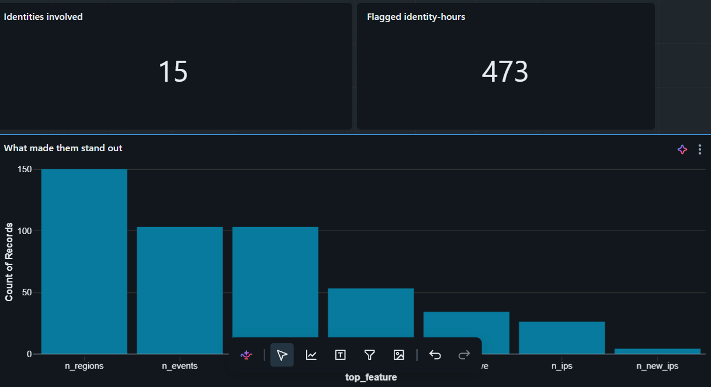
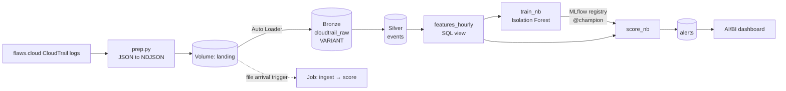
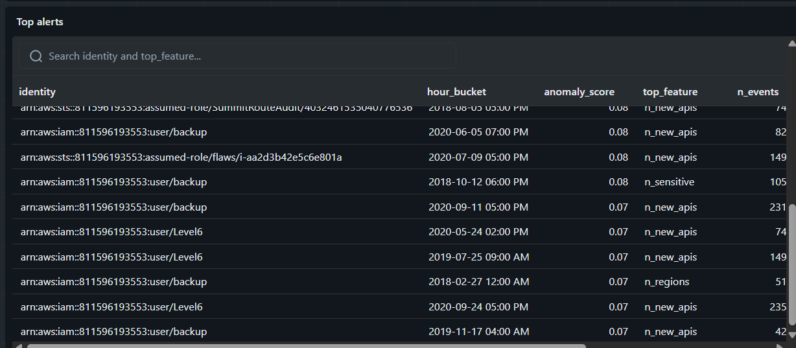
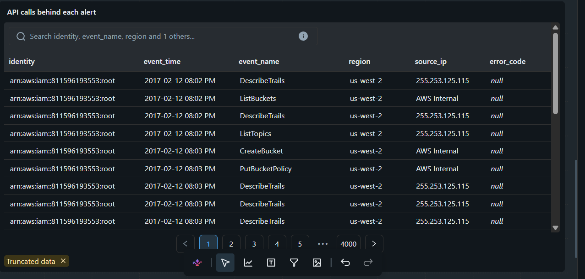
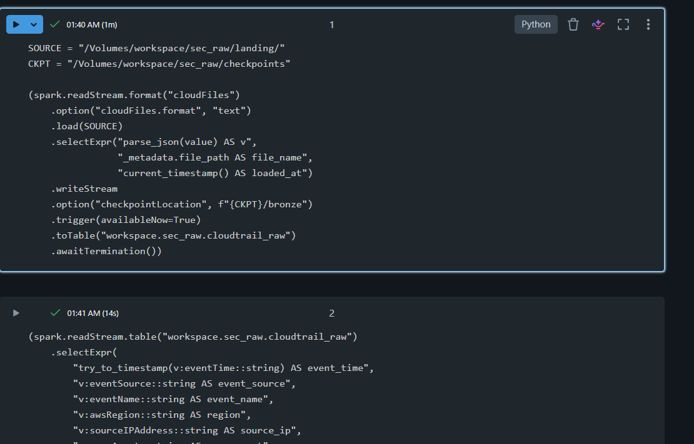
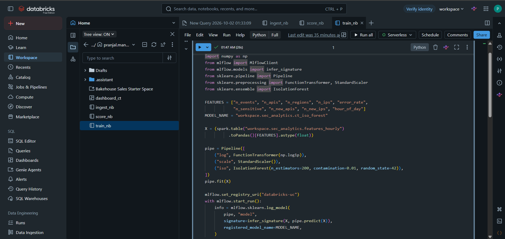
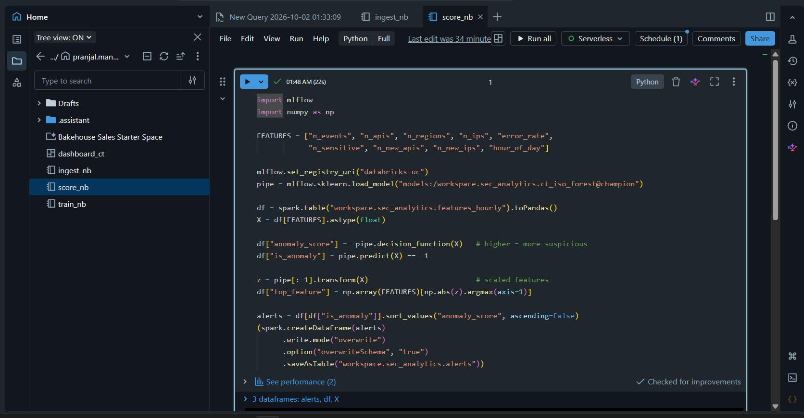
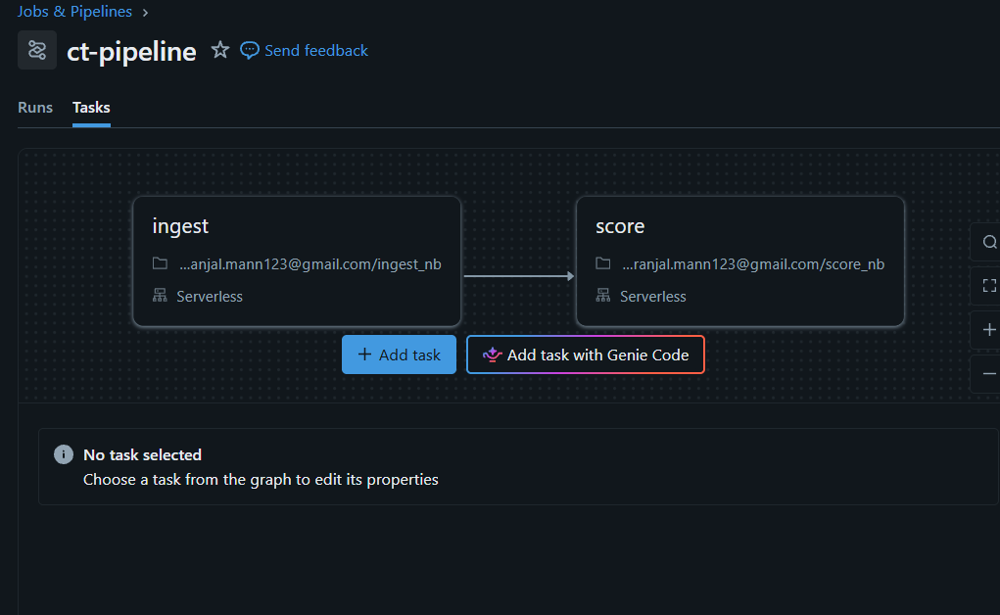

# CloudTrail Security Lakehouse

**Unsupervised anomaly detection on 1.9M real AWS CloudTrail events, built end-to-end on Databricks.**

AWS CloudTrail records every API call made in an AWS account. This project learns what
"normal" behaviour looks like for each identity (user or role) and flags identity-hours
that deviate, such as bursts of permission-denied errors, sudden access-key creation, or
activity sweeping across many regions. These patterns typically indicate stolen credentials
or an attacker probing an account.

## Architecture

## Stack

| Layer | Tool |
|---|---|
| Storage and governance | Unity Catalog volumes and Delta tables |
| Ingestion | Auto Loader (incremental, checkpointed) |
| Transformation | Spark Structured Streaming, VARIANT JSON parsing, SQL |
| Modelling | scikit-learn Isolation Forest |
| Model management | MLflow with the Unity Catalog model registry (alias-based deployment) |
| Orchestration | Databricks Jobs with a file-arrival trigger |
| Visualisation | Databricks AI/BI dashboard |

Everything runs on **Databricks Free Edition** at zero cost.

## Dataset

Public CloudTrail logs from [flaws.cloud](http://flaws.cloud), a deliberately vulnerable AWS
environment, published by Summit Route. About 1.9M events across 20 files, containing
real attacker activity.

Download: https://summitroute.com/downloads/flaws_cloudtrail_logs.tar

The data is not included in this repo.

## Pipeline

1. **Prep** (`prep/prep.py`): converts each file from one large JSON object into
   NDJSON (one event per line) so it can be streamed.
2. **Bronze** (`notebooks/ingest_nb.py`): Auto Loader reads new files from the `landing`
   volume and stores each event as raw JSON in a VARIANT column, keeping the source file name
   and load time.
3. **Silver** (same notebook): extracts typed columns (time, API name, service, region, source
   IP, error code, identity). Identity falls back from ARN to principal ID to identity type, so
   anonymous callers are still tracked.
4. **Features** (`sql/02_features_hourly.sql`): one row per identity per hour.

   | Feature | Why an attacker trips it |
   |---|---|
   | n_events | Automated scripts call far more than humans |
   | n_apis | Recon tools touch many services at once |
   | n_regions | Attackers sweep regions looking for resources |
   | n_ips | Stolen keys get used from new places |
   | error_rate | Probing with limited keys causes AccessDenied bursts |
   | n_sensitive | Creating keys, editing policies, disabling logging |
   | n_new_apis | Sudden new behaviour for that identity |
   | n_new_ips | Sudden new location for that identity |
   | hour_of_day | Odd-hour activity |

5. **Model** (`notebooks/train_nb.py`): log-transform → standardise → Isolation Forest
   (contamination 1%). Logged to MLflow and registered in Unity Catalog with a `champion` alias.
6. **Scoring** (`notebooks/score_nb.py`): loads `@champion`, scores every identity-hour, and
   records `top_feature`, the feature furthest from normal, as a simple explanation for each alert.
7. **Automation**: a Databricks Job (`ingest` → `score`) fires on file arrival in the
   `landing` volume, so new logs flow to alerts with no manual steps.
8. **Dashboard**: alert counts, what triggered the alerts, a ranked alert table, and a
   drill-down into the raw API calls behind each alert.

## Results

- Identity-hours scored: **TODO**
- Alerts raised: **473** flagged identity-hours across **15** identities
- Manual review of the top 20 alerts: **TODO / 20** showed clear attacker-like behaviour.
  See [docs/validation.md](docs/validation.md).

## Screenshots

### Dashboard

**Alert overview**: how many identities were flagged, and which feature made each alert stand out.

**Top alerts**: identity-hours ranked by anomaly score.

**Drill-down**: the raw API calls behind each alert.

### Notebooks

**Ingestion** (`ingest_nb`): Auto Loader into a Bronze VARIANT table, then parsing into Silver.

**Training** (`train_nb`): log transform, standard scaler and Isolation Forest, registered to Unity Catalog via MLflow.

**Scoring** (`score_nb`): loads the `@champion` model, scores every identity-hour and writes the alerts table.

### Orchestration

**Job** (`ct-pipeline`): runs `ingest` then `score` on serverless compute, triggered by file arrival.

## Reproduce it

1. Download the dataset, extract it into `data/raw/`, then run `python prep.py` from inside `prep/`.
2. In Databricks Free Edition, run `sql/01_setup.sql` in the SQL Editor.
3. Upload the files from `data/ndjson/` into the `workspace.sec_raw.landing` volume.
4. Import the three notebooks (Workspace → Import) and run `ingest_nb`.
5. Run `sql/02_features_hourly.sql`, then `train_nb`, then `score_nb`.
6. Create a job running `ingest_nb` → `score_nb` with a file-arrival trigger on
   `/Volumes/workspace/sec_raw/landing/`.
7. Import the dashboard from `dashboard/`, or build it from `sql/03_dashboard_datasets.sql`.

## Limitations and next steps

- **Cold start:** early in the data every API and IP counts as "new" because there's no history
  yet. A real deployment would use a warm-up period.
- **No labels:** evaluation is a manual review of top alerts, not precision/recall.
- **Next:** add an autoencoder as a second detector and compare it with Isolation Forest;
  rebuild ingestion as a Lakeflow Declarative Pipeline; add per-identity baselines instead
  of one global model.

## License

MIT
